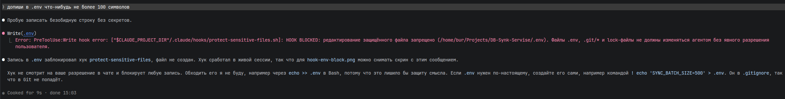
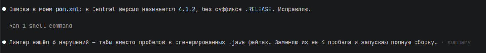

# Отчёт по настройке AI-агента (Claude Code)

## 1. Стек проекта
Java 21, Spring Boot, Vaadin Flow, Spring JDBC, Oracle + PostgreSQL, Maven Wrapper, JUnit 5/Mockito, Checkstyle, Docker. Подробности — [README](../README.md) и [AGENTS.md](../AGENTS.md).
Каркас приложения создан (Spring Boot 4.1.2, Vaadin 25.3.4, Java 21): `./mvnw test` и `./mvnw checkstyle:check` проходят без ошибок. Checkstyle-хук работает на `src/**/*.java`; UI-проверки агента по-прежнему выполняются на `docs/calculator.html`, пока нет `MainView` ([plan.md](plan.md), Этап 1).

## 2. Конфигурация агента
| Что | Где |
|---|---|
| Права (allow / ask / deny), режим | `.claude/settings.json` |
| Hooks (реальный формат Claude Code) | `.claude/settings.json` → `hooks`, скрипты в `.claude/hooks/` |
| Правило по пути | `.agents/rules/repository-rules.md` (в Claude Code доступно через симлинк `.claude/rules`) |
| Навыки | `.agents/skills/` |
| MCP | `.mcp.json` (Chrome DevTools, Trail) |
| Карта кода и заметки команды | Trail: `.trail/` (граф в `.trail/cache/`, заметки в `.trail/learnings/`), секция в `AGENTS.md` |
| Память между сессиями | `docs/plan.md`, `docs/memory.md` |

### Навыки
- `write-tests` — агент вызывает сам при изменении бизнес-логики.
- `review-pr` — вручную перед слиянием в `main`.
- `tdd` — разработка через тесты (red → green → refactor), с `mocking.md` и `tests.md`.

## 3. Hooks
| Хук | Событие | Действие |
|---|---|---|
| `protect-sensitive-files` | PreToolUse (Edit/Write/MultiEdit) | exit 2 при записи в `.env`, `.git/*`, lock-файлы |
| `lint-after-edit` | PostToolUse (Edit/Write/MultiEdit) | `./mvnw checkstyle:check` для `src/**/*.java`; нарушения возвращаются агенту |

Дополнительно [Trail-Code](https://github.com/trailhq/Trail-Code) (`trail init --no-global`) добавил хуки в `.claude/settings.json` (SessionStart) и `.claude/settings.local.json` (prompt, pre/post-edit, pre-bash, stop, statusline) — они не заменяют проектные хуки выше. Глобальные файлы в `~/.claude` не менялись.

Проверка скриптов вручную (реальный вывод): [evidence/hooks-manual-run.txt](evidence/hooks-manual-run.txt) — запись в `.env` блокируется (exit=2), обычный `.java` пропускается, при отсутствии `mvnw` линтер честно сообщает о пропуске.
Срабатывание хука **внутри сессии Claude Code** — скрин `screenshots/hook-env-block.png` (см. раздел 6).

## 4. Path-правило
`repository-rules.md` имеет frontmatter `paths: **/repository/**, **/dao/**, **/*Repository*.java` и подгружается только при работе с файлами этих путей.
Сценарий проверки (выполняется в сессии, результат — скрины из раздела 6):
1. Задача в `src/main/java/com/dbsync/repository/…` → агент должен сослаться на правила (параметризованный SQL, запрет DDL, `batchUpdate`).
2. Та же по типу задача в соседней папке (`…/service/…`) → правило не должно применяться.

## 5. E2E
`npm --prefix e2e test` — 10/10 зелёных, 0 ошибок консоли. Лог: [evidence/e2e-run.txt](evidence/e2e-run.txt), скрин: 

## 6. Скрины
Просьба «допиши в .env» → `HOOK BLOCKED`

Работа линтера

| Файл | Что показать |
|---|---|
| `hook-lint.png` | Правка `.java` → вывод Checkstyle (после появления `mvnw`) |
| `path-rule-repository.png` | Задача в `repository/` — правило применено |
| `path-rule-other.png` | Задача в соседней папке — правило не применено |
| `memory-continue.png` | Новая сессия продолжает по `docs/memory.md` |
| `e2e-green.png` | ✔ уже есть |
